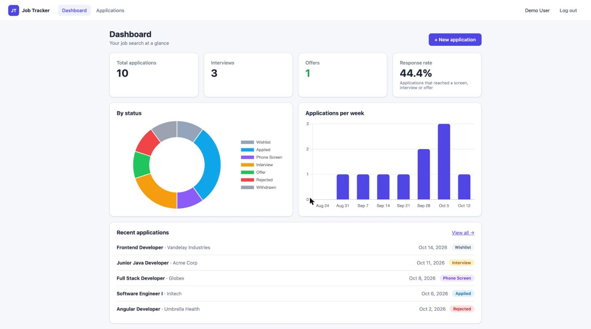
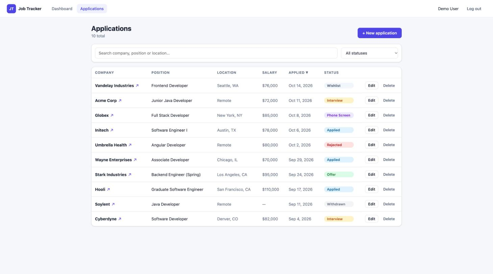
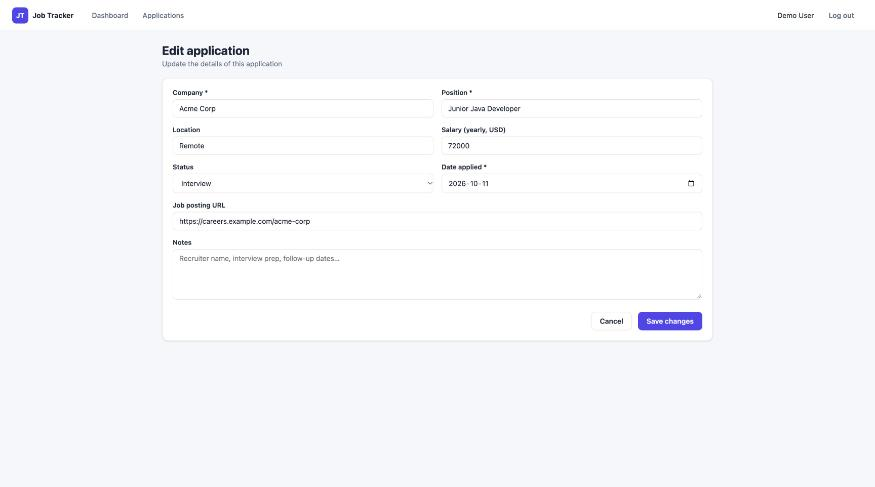

# Job Application Tracker

A full-stack web app for organizing a job search: record every application, move it through the
hiring pipeline (Wishlist → Applied → Phone Screen → Interview → Offer), and see your progress on a dashboard.

Built with **Spring Boot 3 (Java 17)** and **Angular 17**. Includes JWT authentication, a PostgreSQL schema
managed by Flyway, automated tests on both ends, Docker, and CI.



## Features

- **Accounts**: register and log in with JWT-based, stateless authentication; passwords hashed with BCrypt
- **Applications CRUD**: company, position, location, salary, job link, date and notes, with validation on both client and server
- **Pipeline status**: change status inline from the list (HTTP `PATCH`)
- **Search, filter, sort, paginate**: all done server-side with JPA Specifications
- **Dashboard**: totals, response rate, a doughnut chart by status and a bar chart of applications per week (Chart.js)
- **Data isolation**: users can only ever see and change their own records
- **API docs**: interactive Swagger UI
- **Demo account**: seeded automatically (`demo@example.com` / `password123`)

| Applications list | Edit form |
|---|---|
|  |  |

## Tech stack

| Layer | Technology |
|---|---|
| Frontend | Angular 17 (standalone components, signals, new control flow), Reactive Forms, RxJS, Chart.js, SCSS |
| Backend | Spring Boot 3.5, Spring Web, Spring Data JPA (Hibernate), Spring Security, Bean Validation, jjwt, springdoc-openapi |
| Database | PostgreSQL 16 (production), H2 in-memory (development and tests), Flyway migrations |
| Testing | JUnit 5, Mockito, MockMvc, AssertJ; Jasmine + Karma |
| DevOps | Docker multi-stage builds, docker-compose, nginx, GitHub Actions |

## Quick start

### Option A: run locally (no database to install)

Requirements: Java 17+, Node 18+.

```bash
# Terminal 1: API on http://localhost:8080 (H2 in-memory DB, demo data seeded)
cd backend
./mvnw spring-boot:run

# Terminal 2: UI on http://localhost:4200 (proxies /api to the backend)
cd frontend
npm install
npm start
```

Open http://localhost:4200 and click **"Use the demo account"**.

- Swagger UI: http://localhost:8080/swagger-ui.html
- H2 console: http://localhost:8080/h2-console (JDBC URL `jdbc:h2:mem:jobtracker`, user `sa`, no password)

### Option B: Docker (PostgreSQL + API + nginx)

```bash
docker compose up --build
```

Open http://localhost:8091.

### Running the tests

```bash
cd backend && ./mvnw test
cd frontend && npx ng test --watch=false --browsers=ChromeHeadless
```

## Running in IntelliJ IDEA or VS Code

Both editors work. The repo includes ready-made run configurations for each one
(`.run/` for IntelliJ, `.vscode/` for VS Code), so you don't have to set anything up by hand.

**You need:** JDK 17+, Node.js 18+ (Angular 17 requires 18.13 or newer) and npm. You don't need Maven:
the project uses the Maven Wrapper (`mvnw`).

| | Backend (Spring Boot API) | Frontend (Angular) |
|---|---|---|
| URL | http://localhost:8080 (Swagger: `/swagger-ui.html`) | http://localhost:4200 |
| Entry point | `backend/src/main/java/com/portfolio/jobtracker/JobTrackerApplication.java` | `frontend/` → `npm start` |

Start the **backend first**, then the frontend. The frontend dev server forwards `/api` calls to port 8080.
Then open http://localhost:4200 and click **Use the demo account** (`demo@example.com` / `password123`).

### IntelliJ IDEA (Community or Ultimate)

1. **Open the project:** *File → Open…* and select the **repository root folder** (the one containing `backend/` and `frontend/`).
   If IntelliJ doesn't import Maven automatically, right-click `backend/pom.xml` → **Add as Maven Project**.
2. **Set the JDK:** *File → Project Structure → Project → SDK* → choose a **17** (or newer) JDK.
   If none is listed, use *Add SDK → Download JDK* (for example Eclipse Temurin 17).
3. **Use the Maven Wrapper:** *Settings → Build, Execution, Deployment → Build Tools → Maven* → **Maven home path: Use Maven wrapper**.
4. **Run the backend:** choose **Backend (Spring Boot)** in the run-configuration dropdown (top right) and click ▶ Run or 🐞 Debug.
   Or open `JobTrackerApplication.java` and click the green ▶ next to `main`. Wait for `Started JobTrackerApplication in … seconds` in the console.
5. **Run the frontend:**
   - **Ultimate:** choose the **Frontend (npm start)** run configuration and click ▶. The first time, right-click `frontend/package.json` → **Run 'npm install'**.
   - **Community** (no JavaScript support): open the **Terminal** tool window and run:
     ```bash
     cd frontend
     npm install   # first time only
     npm start
     ```
6. **Run the tests:** choose the **Backend tests** configuration, or right-click `backend/src/test/java` → **Run 'All Tests'**.
   Frontend tests run in the terminal: `cd frontend && npx ng test --watch=false --browsers=ChromeHeadless`.

> **Tip:** in Ultimate, the *Services* tool window shows the Spring Boot app with its endpoints and health.
> To debug, set breakpoints in a controller or service and start **Backend (Spring Boot)** with 🐞 Debug.

### VS Code

1. **Open the folder:** *File → Open Folder…* and select the **repository root**.
2. **Install the recommended extensions** when VS Code prompts you (they're listed in `.vscode/extensions.json`):
   - **Extension Pack for Java**: Java language support, Maven, debugger, test runner
   - **Spring Boot Extension Pack**: Spring Boot tools + Spring Boot Dashboard
   - **Angular Language Service**: template autocompletion and errors

   When the Java extension asks, choose **Trust** and let it import the Maven project
   (the status bar shows "Java: Ready" when it's done).
3. **Run everything with one click:** open *Run and Debug* (Ctrl/Cmd + Shift + D), pick
   **Full stack (backend + frontend)** and press ▶. This starts the Spring Boot API with the debugger attached,
   runs `npm start`, and opens Chrome with the Angular debugger attached.
   The first time, run *Terminal → Run Task… → **Frontend: npm install*** before pressing ▶.
4. **Or run the pieces separately:**
   - Backend: **Backend (Spring Boot)** in *Run and Debug*, or ▶ next to the app in the *Spring Boot Dashboard*,
     or *Terminal → Run Task… → **Backend: run (mvnw spring-boot:run)***.
   - Frontend: *Terminal → Run Task… → **Frontend: npm start***.
5. **Tests:** the *Testing* panel (beaker icon) lists every JUnit test. You can also use
   *Terminal → Run Task… → **Backend: tests*** / **Frontend: tests**.

### Troubleshooting

| Problem | Fix |
|---|---|
| `Port 8080 was already in use` | Another app (or a previous run) is using it. Stop it, or change `server.port` in `backend/src/main/resources/application.yml` **and** `target` in `frontend/proxy.conf.json`. |
| `Port 4200 is already in use` | Run `npx ng serve --port <other>` inside `frontend/`. |
| Login fails / "Cannot reach the server" | The backend isn't running, or not on port 8080. Start it first. |
| Java errors such as "release version 17 not supported" | The project/IDE is using an older JDK. Select JDK 17+ (step 2 above). |
| Red imports in VS Code | Run *Command Palette → **Java: Clean Java Language Server Workspace*** and reload. |
| `ng: command not found` | Use `npm start` / `npx ng …` (they use the project's local Angular CLI) after `npm install`. |
| H2 console | http://localhost:8080/h2-console, JDBC URL `jdbc:h2:mem:jobtracker`, user `sa`, empty password (the DB lives in memory and resets on restart). |

## Documentation

**[docs/HOW-IT-WORKS.md](docs/HOW-IT-WORKS.md)** is a detailed walkthrough of the architecture, the
request lifecycle, security, the data model, every API endpoint, the frontend, testing and deployment.

The source code is also heavily commented, so you can read it top to bottom as a tutorial.

## Project structure

```
job-tracker/
├── backend/            Spring Boot REST API
│   └── src/main/java/com/portfolio/jobtracker/
│       ├── auth/           register / login / me endpoints
│       ├── user/           User entity + repository
│       ├── security/       JWT creation/validation + request filter
│       ├── application/    job application entity, repository, service, controller, DTOs
│       ├── common/         error handling, pagination wrapper
│       └── config/         security, OpenAPI, clock, demo data
├── frontend/           Angular single-page app
│   └── src/app/
│       ├── core/           models, auth (service/interceptor/guards), API services
│       ├── features/       auth pages, dashboard, applications list + form
│       └── shared/         pipes and helpers
├── docs/               documentation and screenshots
├── docker-compose.yml
└── .github/workflows/ci.yml
```
