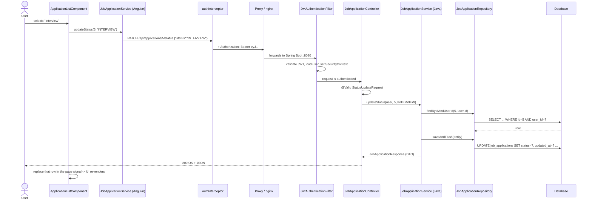
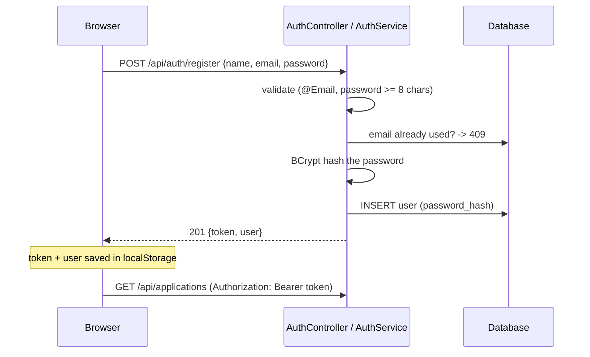
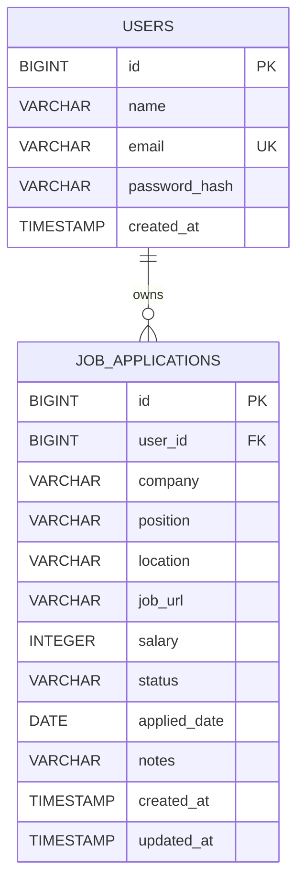
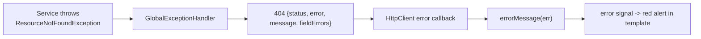
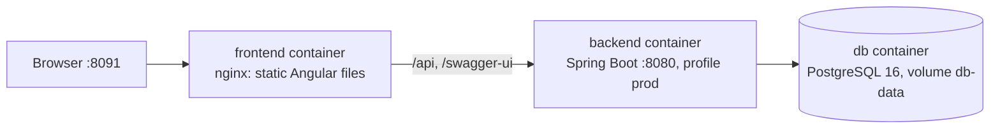

# How the Job Application Tracker Works

This guide explains the whole application, from the moment you click a button in the browser to
the row that changes in the database. It is written for developers who are new to Spring Boot
and/or Angular. Read it alongside the source code, which is commented in detail.

**Contents**

1. [Overview](#1-overview)
2. [Tech stack and why](#2-tech-stack-and-why)
3. [Architecture](#3-architecture)
4. [Project structure](#4-project-structure)
5. [Life of a request](#5-life-of-a-request)
6. [Authentication and security](#6-authentication-and-security)
7. [Data model](#7-data-model)
8. [Business rules](#8-business-rules)
9. [API reference](#9-api-reference)
10. [The backend, layer by layer](#10-the-backend-layer-by-layer)
11. [The frontend explained](#11-the-frontend-explained)
12. [Error handling end to end](#12-error-handling-end-to-end)
13. [Testing](#13-testing)
14. [Configuration and profiles](#14-configuration-and-profiles)
15. [Docker and deployment](#15-docker-and-deployment)
16. [Interview talking points](#16-interview-talking-points)
17. [Glossary](#17-glossary)

---

## 1. Overview

The app helps a job seeker keep track of applications. A user can:

| Feature | Where |
|---|---|
| Register / log in | `/register`, `/login` |
| See totals, response rate, charts and recent applications | `/dashboard` |
| List, search, filter by status, sort and page through applications | `/applications` |
| Change an application's status straight from the list | status dropdown in each row |
| Create and edit applications | `/applications/new`, `/applications/:id/edit` |
| Delete applications (with inline confirmation) | list page |

The application has two independent programs:

- **Backend**: a Spring Boot REST API (Java). It owns the data and every rule. It speaks JSON only.
- **Frontend**: an Angular single-page application (TypeScript). It runs in the browser, shows the UI
  and calls the API.

They communicate only over HTTP with JSON. Either side could be replaced (a mobile app, for example)
without changing the other.

---

## 2. Tech stack and why

| Choice | Why |
|---|---|
| **Java 17 + Spring Boot 3.5** | The most common enterprise Java stack. Auto-configuration means very little setup code; records and modern Java features keep the code concise. |
| **Spring Web (MVC)** | Annotation-based REST controllers (`@GetMapping`, `@RequestBody`) with automatic JSON conversion by Jackson. |
| **Spring Data JPA / Hibernate** | Map Java classes to tables; repositories are interfaces whose implementations are generated. |
| **Spring Security + JWT (jjwt)** | Industry standard for securing APIs. JWT keeps the server stateless (no sessions), which suits SPAs and horizontal scaling. |
| **Bean Validation** | Declarative input rules (`@NotBlank`, `@Size`) that produce clean 400 responses. |
| **Flyway** | Versioned SQL migrations: the schema is code, reviewed and reproducible on every machine. |
| **PostgreSQL / H2** | Postgres in production; H2 in-memory for zero-setup development and fast tests (running in PostgreSQL compatibility mode). |
| **springdoc-openapi** | Generates Swagger UI from the controllers, so reviewers can try the API in a browser. |
| **Angular 17** | Full framework with routing, forms, HTTP and DI built in. Uses modern features: standalone components, signals, `@if`/`@for`. |
| **RxJS** | Angular's HTTP client returns Observables; operators like `debounceTime` make search-as-you-type easy. |
| **Chart.js** | Lightweight, well-known charting library. |
| **Docker / docker-compose / nginx** | One command starts the whole production-like stack. |
| **GitHub Actions** | Every push is built and tested automatically. |

---

## 3. Architecture

```mermaid
flowchart LR
    subgraph Browser
        UI[Angular components] --> SVC[Angular services]
        SVC --> INT[JWT interceptor]
    end
    INT -- "HTTP /api/... + Bearer token" --> PROXY[Dev: Angular proxy<br/>Prod: nginx]
    PROXY --> FILTER

    subgraph "Spring Boot (port 8080)"
        FILTER[Security filter chain<br/>JwtAuthenticationFilter] --> CTRL[Controllers<br/>@RestController]
        CTRL --> SERV[Services<br/>@Service @Transactional]
        SERV --> REPO[Repositories<br/>Spring Data JPA]
        CTRL -. exceptions .-> ADV[GlobalExceptionHandler]
    end
    REPO --> DB[(PostgreSQL / H2)]
```

**Layered backend.** Each layer has one job and only talks to the layer below it:

| Layer | Responsibility | Knows about HTTP? | Knows about SQL? |
|---|---|---|---|
| Controller | Map URLs to methods, validate input, choose status codes | yes | no |
| Service | Business rules, ownership checks, transactions | no | no |
| Repository | Read/write the database | no | yes (generated) |
| Entity | Java representation of a table row | no | mapping only |
| DTO | Shape of JSON going in/out of the API | (data only) | no |

**Single origin.** In both development and production the browser only talks to one origin
(`localhost:4200` in dev, the nginx host in Docker). That server forwards `/api/*` to Spring Boot.
This avoids CORS problems and means the frontend can use relative URLs like `/api/applications`.

---

## 4. Project structure

```
job-tracker/
├── README.md                          Project pitch, quick start
├── docker-compose.yml                 Postgres + backend + frontend (nginx) in one command
├── .github/workflows/ci.yml           GitHub Actions: build + test backend and frontend
├── docs/
│   ├── HOW-IT-WORKS.md                This guide
│   └── screenshots/                   Images used by the README
│
├── backend/
│   ├── pom.xml                        Maven build: dependencies and plugins
│   ├── mvnw, mvnw.cmd, .mvn/          Maven Wrapper: builds without installing Maven
│   ├── Dockerfile                     Multi-stage build: Maven -> small JRE image
│   └── src/
│       ├── main/java/com/portfolio/jobtracker/
│       │   ├── JobTrackerApplication.java          main() - starts Spring Boot
│       │   ├── auth/
│       │   │   ├── AuthController.java             POST /register, POST /login, GET /me
│       │   │   ├── AuthService.java                registration + login logic
│       │   │   └── dto/                            RegisterRequest, LoginRequest, AuthResponse, UserResponse
│       │   ├── user/
│       │   │   ├── User.java                       @Entity users table; also the Spring Security principal
│       │   │   └── UserRepository.java             find by email
│       │   ├── security/
│       │   │   ├── JwtService.java                 create + validate JWTs
│       │   │   └── JwtAuthenticationFilter.java    reads "Authorization: Bearer" on every request
│       │   ├── application/
│       │   │   ├── ApplicationStatus.java          enum: WISHLIST ... WITHDRAWN
│       │   │   ├── JobApplication.java             @Entity job_applications table
│       │   │   ├── JobApplicationRepository.java   queries incl. GROUP BY stats
│       │   │   ├── JobApplicationSpecifications.java dynamic WHERE clauses for search
│       │   │   ├── JobApplicationService.java      business logic + ownership checks + stats
│       │   │   ├── JobApplicationController.java   /api/applications endpoints
│       │   │   └── dto/                            request/response records, stats records
│       │   ├── common/
│       │   │   ├── ApiError.java                   JSON error body
│       │   │   ├── GlobalExceptionHandler.java     exception -> HTTP status mapping
│       │   │   ├── PageResponse.java               pagination wrapper
│       │   │   ├── ResourceNotFoundException.java  -> 404
│       │   │   └── ConflictException.java          -> 409
│       │   └── config/
│       │       ├── SecurityConfig.java             filter chain, BCrypt, CORS
│       │       ├── OpenApiConfig.java              Swagger "Authorize" button
│       │       ├── ClockConfig.java                injectable Clock (testable dates)
│       │       └── DemoDataSeeder.java             creates the demo account at startup
│       ├── main/resources/
│       │   ├── application.yml                     default config (H2)
│       │   ├── application-prod.yml                production overrides (Postgres, env vars)
│       │   └── db/migration/V1__create_tables.sql  Flyway schema
│       └── test/java/com/portfolio/jobtracker/
│           ├── ApiIntegrationTest.java             full HTTP tests with MockMvc
│           └── application/JobApplicationServiceTest.java  unit tests with Mockito
│
└── frontend/
    ├── package.json                   npm dependencies and scripts
    ├── angular.json                   Angular CLI config (build, serve with proxy, test)
    ├── proxy.conf.json                dev server forwards /api to localhost:8080
    ├── Dockerfile                     node build -> nginx image
    ├── nginx.conf                     serves the SPA, proxies /api to the backend container
    └── src/
        ├── index.html, main.ts        page shell + bootstrap
        ├── styles.scss                global design system (colors, buttons, forms, badges, tables)
        └── app/
            ├── app.config.ts          providers: router, HttpClient + interceptor
            ├── app.routes.ts          URL -> component, lazy loading, guards
            ├── app.component.*        navbar + <router-outlet>
            ├── core/
            │   ├── models.ts                       TypeScript interfaces mirroring the API DTOs
            │   ├── auth/auth.service.ts            login/register/logout, current user signal
            │   ├── auth/auth.interceptor.ts        adds the Bearer token, handles 401
            │   ├── auth/auth.guard.ts              authGuard / guestGuard
            │   └── api/job-application.service.ts  typed wrappers for /api/applications
            ├── shared/
            │   ├── status-label.pipe.ts            PHONE_SCREEN -> "Phone Screen"
            │   └── error-message.ts                HTTP error -> readable message
            └── features/
                ├── auth/                           login + register pages
                ├── dashboard/                      cards + charts + recent list
                └── applications/                   list page + create/edit form
```

---

## 5. Life of a request

Let's follow one real action: **the user changes an application's status from "Applied" to
"Interview" using the dropdown in the list.**



Step by step:

1. **Template event.** In `application-list.component.html` the `<select>` has
   `(change)="changeStatus(app, $any($event.target).value)"`. Angular calls the component method.
2. **Component -> service.** `changeStatus()` calls `api.updateStatus(id, status)` and subscribes.
   HttpClient Observables are lazy: nothing is sent until `subscribe()`.
3. **Interceptor.** `authInterceptor` clones the request and adds `Authorization: Bearer <token>`
   (read from `localStorage`).
4. **Proxy.** The browser sends the request to its own origin. In development the Angular dev
   server forwards `/api/*` to `localhost:8080` (`proxy.conf.json`); in Docker, nginx forwards to the
   `backend` container (`nginx.conf`).
5. **Security filter.** `JwtAuthenticationFilter` checks the token's signature and expiry,
   loads the user from the database, and stores it in the `SecurityContext`.
   `SecurityConfig` requires authentication for everything except the public endpoints, so a request
   without a valid token stops here with **401**.
6. **Controller.** Spring matches `PATCH /api/applications/{id}/status` to
   `JobApplicationController.updateStatus`. It converts the JSON body into a `StatusUpdateRequest`
   record and validates it (`@Valid` + `@NotNull`). `@AuthenticationPrincipal` injects the user from step 5.
7. **Service.** `JobApplicationService.updateStatus` runs inside a transaction (`@Transactional`).
   `findOwned()` queries by **id and user id**. If the record belongs to someone else it simply isn't
   found, so the result is **404**.
8. **Repository / database.** Hibernate issues the `SELECT`, and after the status change the `UPDATE`.
   The `@PreUpdate` callback on the entity refreshes `updatedAt` automatically.
9. **Response.** The entity is converted to a `JobApplicationResponse` record, which Jackson
   serializes to JSON. Status 200.
10. **UI update.** The component replaces just that row inside its `page` signal. Angular notices the
    signal changed and re-renders the row with the new badge color.

---

## 6. Authentication and security

### 6.1 Registration and login



- **Passwords are never stored.** `BCryptPasswordEncoder.encode()` produces a salted, slow hash
  such as `$2a$10$...`. At login, `matches(raw, hash)` re-hashes the attempt with the same salt and compares.
- **Same error for unknown email and wrong password** ("Invalid email or password"), so attackers
  can't find out which emails are registered.
- **Registering logs you in**: the response already contains a token.

### 6.2 What is inside the JWT?

A token looks like `eyJhbGciOiJIUzM4NCJ9.eyJzdWIiOiJkZW1vQGV4YW1wbGUuY29tIi...`. Decoded:

```json
// header
{ "alg": "HS384" }
// payload (claims)
{ "sub": "demo@example.com", "name": "Demo User", "iat": 1760450000, "exp": 1760536400 }
// signature = HMAC-SHA384(header + "." + payload, secretKey)
```

- The payload is **readable by anyone** (Base64), so it contains no secrets.
- It **cannot be modified**, because the signature would no longer match. Only the server knows `JWT_SECRET`.
- `exp` makes it expire after 24 h (`app.jwt.expiration-ms`).

### 6.3 Why stateless?

The server keeps **no session**. Every request carries its token, and `JwtAuthenticationFilter`
re-authenticates it. Benefits: any number of backend instances can serve any request, and there is
no session store. Trade-off: a token can't be revoked before it expires. Possible improvements are
short-lived access tokens plus refresh tokens, or a token deny-list.

### 6.4 Security configuration (`SecurityConfig`)

| Setting | Meaning |
|---|---|
| `csrf.disable()` | CSRF exploits cookies. We use an `Authorization` header that JavaScript adds explicitly, so CSRF does not apply. |
| `SessionCreationPolicy.STATELESS` | Never create an `HttpSession`. |
| `permitAll()` on `/api/auth/register`, `/api/auth/login`, Swagger, H2 console | Public endpoints |
| `anyRequest().authenticated()` | Everything else needs a valid token |
| `HttpStatusEntryPoint(401)` | Anonymous requests get a clean 401 instead of a redirect to a login page |
| `addFilterBefore(JwtAuthenticationFilter)` | Our filter runs early in the chain |

### 6.5 Data isolation

Every repository call in the service is scoped to the current user:
`findByIdAndUserId(id, user.getId())`, and the search specification always starts with
`ownedBy(userId)`. Asking for another user's application returns **404 Not Found** (not 403),
so the API doesn't even reveal that the id exists. `ApiIntegrationTest.usersCannotSeeEachOthersApplications`
proves this.

### 6.6 Frontend side

| Piece | What it does |
|---|---|
| `AuthService` | Calls login/register, stores `jobtracker.token` and `jobtracker.user` in `localStorage`, exposes `currentUser` and `isLoggedIn` signals |
| `authInterceptor` | Adds `Authorization: Bearer ...` to every request; on a 401 from a non-auth endpoint (token expired), logs out |
| `authGuard` | Blocks private routes for anonymous users (redirects to `/login`) |
| `guestGuard` | Sends logged-in users away from `/login` and `/register` |

> **Guards are UX, not security.** Someone can always bypass browser code. The real protection is
> the backend rejecting requests without a valid token.

*Note on `localStorage`:* it is simple and common, but readable by any script running on the page
(XSS). Angular escapes template output by default, which mitigates this. A hardened alternative is an
`HttpOnly` cookie, which then requires CSRF protection.

---

## 7. Data model



### `users`

| Column | Type | Notes |
|---|---|---|
| id | BIGINT identity | primary key |
| name | VARCHAR(100) | required |
| email | VARCHAR(255) | required, **unique** (also used as the JWT subject) |
| password_hash | VARCHAR(255) | BCrypt hash |
| created_at | TIMESTAMP | set on creation |

### `job_applications`

| Column | Type | Notes |
|---|---|---|
| id | BIGINT identity | primary key |
| user_id | BIGINT | FK -> users.id, `ON DELETE CASCADE` |
| company, position | VARCHAR(150) | required |
| location | VARCHAR(150) | optional |
| job_url | VARCHAR(500) | optional, must start with http(s):// |
| salary | INTEGER | optional, ≥ 0 |
| status | VARCHAR(30) | enum name, e.g. `INTERVIEW` |
| applied_date | DATE | required, not in the future |
| notes | VARCHAR(2000) | optional |
| created_at / updated_at | TIMESTAMP | maintained by `@PrePersist` / `@PreUpdate` |

**Indexes:** `(user_id, status)` for status filtering and counts, and `(user_id, applied_date)` for
date sorting and the weekly chart.

### Flyway

`src/main/resources/db/migration/V1__create_tables.sql` creates everything. At startup Flyway
compares the files with the `flyway_schema_history` table and runs only new ones. To change the schema,
**add** `V2__something.sql` and never edit an applied file. Hibernate runs with `ddl-auto: validate`,
so it fails fast at startup if an entity and a table disagree.

---

## 8. Business rules

| Rule | Where enforced | Test |
|---|---|---|
| Company, position and applied date are required | `JobApplicationRequest` (`@NotBlank`, `@NotNull`) + Angular `Validators.required` | `ApiIntegrationTest.invalidInput_returnsFieldErrors` |
| Applied date cannot be in the future | `@PastOrPresent` + `[max]` on the date input | (validation) |
| Salary ≥ 0 | `@PositiveOrZero` + `Validators.min(0)` | `invalidInput_returnsFieldErrors` |
| Job URL must be http(s) | `@Pattern` + `Validators.pattern` | `invalidInput_returnsFieldErrors` |
| New applications default to APPLIED | `JobApplicationService.apply()` | `JobApplicationServiceTest.create_defaultsStatusToApplied_andTrimsInput` |
| Blank optional text is stored as NULL, text is trimmed | `blankToNull()` | same test |
| Users only access their own data (404 otherwise) | `findOwned()`, `ownedBy()` | `usersCannotSeeEachOthersApplications`, `get_throwsNotFound_whenApplicationBelongsToAnotherUser` |
| Email must be unique | `AuthService.register` (409) + DB unique constraint | `registeringTheSameEmailTwice_returns409` |
| Password ≥ 8 characters | `RegisterRequest` | (validation) |
| Response rate = (phone screens + interviews + offers) ÷ (all except wishlist) | `JobApplicationService.stats()` | `stats_computesTotalsResponseRateAndWeeklyBuckets` |
| Weekly chart: last 8 weeks, Monday-based, empty weeks included | `perWeek()` | same test |

---

## 9. API reference

All endpoints are under `/api`. All except register and login need `Authorization: Bearer <token>`.
Explore them interactively at **`/swagger-ui.html`**.

| Method | Path | Body | Success | Errors |
|---|---|---|---|---|
| POST | `/api/auth/register` | `{name, email, password}` | 201 `{token, user}` | 400, 409 |
| POST | `/api/auth/login` | `{email, password}` | 200 `{token, user}` | 400, 401 |
| GET | `/api/auth/me` | - | 200 `user` | 401 |
| GET | `/api/applications?status=&q=&page=&size=&sort=` | - | 200 `Page<Application>` | 400, 401 |
| GET | `/api/applications/stats` | - | 200 `Stats` | 401 |
| GET | `/api/applications/{id}` | - | 200 `Application` | 401, 404 |
| POST | `/api/applications` | `ApplicationRequest` | 201 `Application` | 400, 401 |
| PUT | `/api/applications/{id}` | `ApplicationRequest` | 200 `Application` | 400, 401, 404 |
| PATCH | `/api/applications/{id}/status` | `{status}` | 200 `Application` | 400, 401, 404 |
| DELETE | `/api/applications/{id}` | - | 204 | 401, 404 |

**Query parameters for the list:**
`status` (one of `WISHLIST, APPLIED, PHONE_SCREEN, INTERVIEW, OFFER, REJECTED, WITHDRAWN`),
`q` (text search in company/position/location), `page` (0-based, default 0), `size` (default 10),
`sort` (`property,direction`, default `appliedDate,desc`).

### Examples

**Login**

```http
POST /api/auth/login
Content-Type: application/json

{ "email": "demo@example.com", "password": "password123" }
```

```json
{
  "token": "eyJhbGciOiJIUzM4NCJ9...",
  "user": { "id": 1, "name": "Demo User", "email": "demo@example.com" }
}
```

**Create an application**

```http
POST /api/applications
Authorization: Bearer eyJ...
Content-Type: application/json

{
  "company": "Acme",
  "position": "Java Developer",
  "location": "Remote",
  "jobUrl": "https://acme.example.com/jobs/1",
  "salary": 70000,
  "status": "APPLIED",
  "appliedDate": "2026-10-14",
  "notes": "Referred by Sam"
}
```

```json
{
  "id": 11, "company": "Acme", "position": "Java Developer", "location": "Remote",
  "jobUrl": "https://acme.example.com/jobs/1", "salary": 70000, "status": "APPLIED",
  "appliedDate": "2026-10-14", "notes": "Referred by Sam",
  "createdAt": "2026-10-14T15:45:05Z", "updatedAt": "2026-10-14T15:45:05Z"
}
```

**List page**

```json
{
  "content": [ { "id": 11, "company": "Acme", "...": "..." } ],
  "page": 0, "size": 10, "totalElements": 11, "totalPages": 2
}
```

**Stats**

```json
{
  "total": 10,
  "byStatus": { "WISHLIST": 1, "APPLIED": 3, "PHONE_SCREEN": 1, "INTERVIEW": 2, "OFFER": 1, "REJECTED": 1, "WITHDRAWN": 1 },
  "perWeek": [ { "weekStart": "2026-08-24", "count": 0 }, "... 8 entries ...", { "weekStart": "2026-10-12", "count": 1 } ],
  "responseRate": 44.4
}
```

**Validation error (400)**

```json
{
  "timestamp": "2026-10-14T15:50:00Z",
  "status": 400,
  "error": "Bad Request",
  "message": "Validation failed",
  "fieldErrors": { "company": "must not be blank", "salary": "must be greater than or equal to 0" }
}
```

---

## 10. The backend, layer by layer

### 10.1 Entities: `User`, `JobApplication`

Plain Java classes annotated for JPA:

```java
@Entity
@Table(name = "job_applications")
public class JobApplication {
    @Id @GeneratedValue(strategy = GenerationType.IDENTITY)
    private Long id;

    @ManyToOne(fetch = FetchType.LAZY, optional = false)
    @JoinColumn(name = "user_id", nullable = false)
    private User user;

    @Enumerated(EnumType.STRING)          // store "INTERVIEW", not 3
    private ApplicationStatus status = ApplicationStatus.APPLIED;

    @PrePersist void onCreate() { createdAt = updatedAt = Instant.now(); }
    @PreUpdate  void onUpdate() { updatedAt = Instant.now(); }
}
```

`User` also implements Spring Security's `UserDetails`, so it can be the authenticated principal directly.

### 10.2 Repositories

```java
public interface JobApplicationRepository
        extends JpaRepository<JobApplication, Long>, JpaSpecificationExecutor<JobApplication> {

    Optional<JobApplication> findByIdAndUserId(Long id, Long userId);      // derived query

    @Query("""
        select new com.portfolio.jobtracker.application.dto.StatusCount(a.status, count(a))
        from JobApplication a where a.user.id = :userId group by a.status
        """)
    List<StatusCount> countByStatus(Long userId);                           // aggregate in SQL
}
```

There is no implementation class: Spring Data generates it at startup from the method names and
`@Query` strings.

### 10.3 Dynamic search with Specifications

```java
var spec = ownedBy(user.getId()).and(hasStatus(status)).and(matches(query));
repository.findAll(spec, pageable);
```

Each `Specification` returns a predicate, or `null` when its filter is empty, and `null` is ignored.
This replaces a combinatorial explosion of hand-written queries. `Pageable` adds `ORDER BY`,
`LIMIT` and `OFFSET`, plus a `COUNT(*)` for `totalElements`.

### 10.4 Service

`JobApplicationService` is annotated `@Transactional`. Key ideas:

- **Ownership check in one place:** `findOwned(user, id)`.
- **DTO conversion:** entities never leave the service. `JobApplicationResponse.from(entity)` builds the record.
- **Injected `Clock`:** `LocalDate.now(clock)` instead of `LocalDate.now()`, so tests can freeze time.
- **Stats:** counts per status come from a `GROUP BY` query; the weekly chart pre-fills 8 Monday-based
  buckets with zero and then counts dates into them.

### 10.5 Controller

```java
@PatchMapping("/{id}/status")
public JobApplicationResponse updateStatus(@AuthenticationPrincipal User user,
                                           @PathVariable Long id,
                                           @Valid @RequestBody StatusUpdateRequest request) {
    return service.updateStatus(user, id, request.status());
}
```

- `@PathVariable`: the `{id}` part of the URL
- `@RequestBody`: the JSON body converted into a record
- `@Valid`: runs the validation annotations, and failures become a 400
- `@ResponseStatus(HttpStatus.CREATED)` / `NO_CONTENT` on POST / DELETE

### 10.6 DTOs as records

```java
public record JobApplicationRequest(
        @NotBlank @Size(max = 150) String company,
        @NotBlank @Size(max = 150) String position,
        ...
        @NotNull @PastOrPresent LocalDate appliedDate,
        @Size(max = 2000) String notes) { }
```

Records are immutable and concise: perfect for data going in and out of the API.

### 10.7 Demo data

`DemoDataSeeder` is a `CommandLineRunner`: Spring runs it once after startup. It only exists when
`app.seed-demo-data=true` (`@ConditionalOnProperty`), and it skips work if the demo user already
exists, so restarting against Postgres doesn't duplicate data.

---

## 11. The frontend explained

### 11.1 Bootstrapping

`main.ts` calls `bootstrapApplication(AppComponent, appConfig)`. `app.config.ts` registers the
router (`provideRouter(routes, withComponentInputBinding())`) and HttpClient with the interceptor
(`provideHttpClient(withInterceptors([authInterceptor]))`). There is no `NgModule`: every component
is **standalone** and lists its own `imports`.

### 11.2 Routing and lazy loading

`app.routes.ts` maps URLs to components with `loadComponent: () => import(...)`. Each page is a
separate JavaScript chunk downloaded the first time it's visited. `canActivate: [authGuard]`
protects private pages. `withComponentInputBinding()` passes the `:id` route parameter straight
into `ApplicationFormComponent`'s `@Input() id`.

### 11.3 Signals: reactive state

```ts
readonly page = signal<Page<JobApplication> | null>(null);   // writable state
readonly isLoggedIn = computed(() => this._currentUser() !== null); // derived state
```

Templates read a signal by calling it (`page()`). When `set()` or `update()` changes it, Angular
re-renders only what depends on it.

### 11.4 New control flow

```html
@if (loading()) { <p>Loading…</p> } @else { ... }
@for (app of page()?.content ?? []; track app.id) { <tr>...</tr> } @empty { <tr>No results</tr> }
```

`track app.id` lets Angular reuse DOM rows when data changes.

### 11.5 Reactive forms

The form model lives in TypeScript:

```ts
readonly form = this.fb.group({
  company: this.fb.nonNullable.control('', [Validators.required, Validators.maxLength(150)]),
  salary:  this.fb.control<number | null>(null, Validators.min(0)),
  ...
});
```

The template binds with `[formGroup]` and `formControlName`. On submit, `markAllAsTouched()`
reveals every error at once. One component serves both create and edit: if `id` is set, it loads
the record with `patchValue()` and calls `update` instead of `create`.

### 11.6 Search as you type

```ts
this.search.valueChanges
  .pipe(debounceTime(300), distinctUntilChanged(), takeUntilDestroyed(this.destroyRef))
  .subscribe(() => this.reload());
```

This waits until typing pauses for 300 ms, skips unchanged values, and unsubscribes automatically
when the page is left.

### 11.7 Dashboard charts

`forkJoin` loads stats and recent applications in parallel. The charts need both the data and the
`<canvas>` elements, so `renderCharts()` is called from both the data callback and `ngAfterViewInit`,
and it only draws when both are ready. Charts are destroyed in `ngOnDestroy` to avoid memory leaks.

### 11.8 Styling

`styles.scss` defines a small design system with CSS variables for colors, plus `.card`, `.btn-*`,
`.input`, `.badge-<STATUS>`, and table styles. Components add only layout-specific SCSS.

---

## 12. Error handling end to end



| Exception | Status | Example cause |
|---|---|---|
| `MethodArgumentNotValidException` | 400 + `fieldErrors` | blank company |
| `HttpMessageNotReadableException`, `MethodArgumentTypeMismatchException` | 400 | invalid JSON, `?status=FOO` |
| no/invalid token (security entry point) | 401 | expired JWT |
| `BadCredentialsException` | 401 | wrong password |
| `ResourceNotFoundException` | 404 | other user's id |
| `ConflictException` | 409 | email already registered |

On the frontend, `shared/error-message.ts` turns any `HttpErrorResponse` into one readable sentence:
field errors are joined, otherwise `message` is used, and status 0 becomes "Cannot reach the server".
The interceptor handles 401 globally by logging out.

---

## 13. Testing

### Backend (`./mvnw test`)

| Test | Type | Proves |
|---|---|---|
| `JobApplicationServiceTest` | Unit (Mockito, no Spring, fixed `Clock`) | defaults and trimming; other users' records are 404; status patch; delete; stats math and weekly buckets |
| `ApiIntegrationTest` | Integration (`@SpringBootTest` + MockMvc + H2) | 401 without/with bad token; wrong password 401; full CRUD + search + filter + stats; user isolation; validation field errors; duplicate email 409 |

Unit tests are fast and pinpoint logic bugs; integration tests prove that security, JSON, validation,
JPA and Flyway work together.

### Frontend (`npx ng test --watch=false --browsers=ChromeHeadless`)

| Spec | Proves |
|---|---|
| `auth.service.spec.ts` | login stores token + user; logout clears them (uses `HttpTestingController`, so no real HTTP) |
| `auth.interceptor.spec.ts` | Bearer header added only when logged in |
| `status-label.pipe.spec.ts` | enum → label |

CI (`.github/workflows/ci.yml`) runs both suites plus a production build on every push.

---

## 14. Configuration and profiles

| File | When used | Database |
|---|---|---|
| `application.yml` | always (defaults) | H2 in-memory |
| `application-prod.yml` | `SPRING_PROFILES_ACTIVE=prod` | PostgreSQL |

Environment variables (production):

| Variable | Purpose | Default |
|---|---|---|
| `SPRING_PROFILES_ACTIVE` | set to `prod` | - |
| `DB_URL` | JDBC URL | `jdbc:postgresql://localhost:5432/jobtracker` |
| `DB_USERNAME` / `DB_PASSWORD` | DB credentials | `jobtracker` / `jobtracker` |
| `JWT_SECRET` | Base64 HMAC key, ≥ 256 bits (`openssl rand -base64 48`) | dev value. **Always override.** |
| `SEED_DEMO_DATA` | create demo account | `true` |
| `CORS_ALLOWED_ORIGINS` | only if UI is on another domain | `http://localhost` |

Frontend: the dev server proxies `/api` to `http://localhost:8080` (`proxy.conf.json`, wired in
`angular.json` → `serve.options.proxyConfig`). `changeOrigin` is `false` so the request stays
same-origin from Spring's point of view, exactly as it is behind nginx.

---

## 15. Docker and deployment



- **`backend/Dockerfile`**: stage 1 uses the Maven image and builds the jar (dependencies cached in
  their own layer); stage 2 copies only the jar onto a small JRE image and runs it as a non-root user.
- **`frontend/Dockerfile`**: stage 1 runs `npm ci` + `ng build`; stage 2 is nginx with the compiled files.
- **`frontend/nginx.conf`**: serves files, forwards `/api` to `http://backend:8080` (Docker DNS name),
  and falls back to `index.html` for Angular routes.
- **`docker-compose.yml`**: starts Postgres with a health check; the backend waits for it
  (`depends_on: condition: service_healthy`).

```bash
docker compose up --build        # start
docker compose down              # stop (data kept in the db-data volume)
docker compose down -v           # stop and delete data
```

### Deploying to the cloud (example: Render or Railway)

1. Push the repo to GitHub.
2. Create a managed **PostgreSQL** database.
3. Create a **web service** from `backend/` (Dockerfile). Set `SPRING_PROFILES_ACTIVE=prod`, `DB_URL`
   (`jdbc:postgresql://host:5432/db`), `DB_USERNAME`, `DB_PASSWORD`, and a strong `JWT_SECRET`.
4. Deploy the frontend either as a second Docker service (edit `proxy_pass` in `nginx.conf` to the
   backend's URL), or as a static site with a rewrite rule `/api/* → backend URL` and
   `/* → /index.html`.
5. Put the live URL in your README and CV.

---

## 16. Interview talking points

**Design decisions you can explain**

- *Layered architecture with DTOs.* Entities never leave the service layer, so the API contract is
  independent of the database schema and there are no lazy-loading surprises during serialization.
- *Stateless JWT auth.* Scales horizontally with no session store. Trade-off: tokens can't be revoked early.
- *404 instead of 403 for other users' data.* This avoids leaking which ids exist.
- *Flyway + `ddl-auto: validate`.* The schema is versioned and reviewed; Hibernate never changes it silently.
- *Aggregation in the database.* `GROUP BY` for per-status counts rather than loading every row.
- *Server-side pagination and filtering.* The browser downloads 10 rows, not thousands.
- *Injected `Clock`.* Date logic is deterministic in tests.
- *Same-origin via proxy/nginx.* No CORS complexity in production.
- *Signals + standalone components.* Modern Angular with less boilerplate and fine-grained reactivity.

**Possible improvements (good "what would you do next?" answers)**

- Refresh tokens / `HttpOnly` cookie storage
- Optimistic locking (`@Version`) to detect concurrent edits
- Testcontainers so integration tests run against real PostgreSQL
- Kanban board view with drag-and-drop between statuses
- Reminders/follow-up dates with email notifications
- File uploads (CV / cover letter per application)
- End-to-end tests with Playwright or Cypress
- Rate limiting on the login endpoint
- Observability: Spring Boot Actuator, structured logging, metrics

---

## 17. Glossary

| Term | Meaning |
|---|---|
| **REST API** | HTTP endpoints that expose resources (`/api/applications`) through verbs (GET, POST, PUT, PATCH, DELETE) |
| **DTO** | Data Transfer Object: a class/record that defines the JSON shape going in or out |
| **Entity** | A Java class mapped to a database table (JPA `@Entity`) |
| **JPA / Hibernate** | The Java standard for ORM / its most popular implementation |
| **ORM** | Object-Relational Mapping: working with objects instead of writing SQL by hand |
| **Repository** | An interface for data access; Spring Data generates the code |
| **Bean** | An object created and managed by Spring, injectable anywhere |
| **Dependency injection** | Objects receive their dependencies instead of creating them, which makes code testable |
| **Transaction** | A group of DB operations that all succeed or all roll back |
| **Migration** | A versioned script that changes the DB schema (Flyway) |
| **JWT** | JSON Web Token: a signed token that proves who the caller is |
| **BCrypt** | A slow, salted password-hashing algorithm |
| **CORS** | A browser rule that blocks reading cross-origin responses unless the server allows it |
| **CSRF** | An attack that abuses automatically sent cookies; not applicable with header tokens |
| **SPA** | Single-Page Application: one HTML page, with JavaScript rendering every screen |
| **Standalone component** | An Angular component that declares its own imports (no NgModule) |
| **Signal** | Angular's reactive value; reading it in a template subscribes automatically |
| **Observable** | An RxJS stream of values over time; HttpClient returns one per request |
| **Interceptor** | Code that runs for every HttpClient request/response |
| **Guard** | A function that allows or blocks navigation to a route |
| **Pipe** | A template value transformer (`{{ date \| date }}`) |
| **Reverse proxy** | A server (nginx) that forwards requests to another server (Spring Boot) |
| **Multi-stage Docker build** | Build in one image, copy only the result into a small runtime image |
| **CI** | Continuous Integration: automated build + tests on every push |
